# Enterprise Hybrid GraphRAG Document Q&A System

[](https://www.python.org/downloads/)
[](https://github.com/langchain-ai/langgraph)
[](https://qdrant.tech/)
[](https://neo4j.com/)
[](interview.md)
[](https://opensource.org/licenses/MIT)

A production-grade, enterprise-ready **Hybrid GraphRAG** system for multi-page PDF document question answering. Combines **layout-aware document parsing**, **parent-child hierarchical chunking**, **open-ended knowledge graph extraction with post-hoc type normalization**, **dual-vector hybrid retrieval (Dense + BM25 via Qdrant RRF)**, **Cross-Encoder reranking**, and a **stateful, self-correcting LangGraph agentic loop** with citation grounding and hallucination verification.

> 📖 **Comprehensive Interview Preparation Guide**: For an exhaustive, end-to-end breakdown from foundational concepts to production-grade system design questions and free study resources, see [**`interview.md`**](interview.md).

---

## 🏛️ System Architecture

```mermaid
flowchart TD
    subgraph Ingestion ["Ingestion & Indexing Pipeline"]
        PDF["Multi-Page PDF"] --> Parser["Layout-Aware Parser<br/>(Unstructured / PDFMiner)"]
        Parser --> Chunker["Parent-Child Hierarchical Chunker"]
        Chunker -->|"Parent Chunks (Large Context)"| ParentStore["Parent Metadata Store"]
        Chunker -->|"Child Chunks (Precision)"| ChildEmbeddings["Embedding Generation<br/>(Dense + BM25 Sparse)"]
        ChildEmbeddings --> Qdrant[("Qdrant Vector DB<br/>Dense + Sparse RRF")]
        Chunker --> KGExtract["LLM Entity & Relation Extractor"]
        KGExtract --> KGNorm["Type Normalizer"]
        KGNorm --> Neo4j[("Neo4j Knowledge Graph")]
    end

    subgraph AgenticLoop ["LangGraph Agentic Self-Correction Loop"]
        UserQuery(["User Question"]) --> QA["1. Query Analysis & Entity Extraction"]
        QA --> HR["2. 3-Way Hybrid Retrieval<br/>(Dense + BM25 RRF + KG Context)"]
        HR --> CE["3. Cross-Encoder Reranking<br/>(ms-marco-MiniLM-L-6-v2)"]
        CE --> Grader{"4. Document Grading<br/>(LLM-as-Judge)"}
        
        Grader -->|"Relevant"| Gen["5. Grounded Generation<br/>(Inline Citations)"]
        Grader -->|"Not Relevant (Retries < 3)"| Rewrite["Query Rewriting"]
        Rewrite --> HR
        Grader -->|"Not Relevant (Retries >= 3)"| FallbackGen["Fallback Generation<br/>(Best-Effort Caveats)"]

        Gen --> HallucinationGuard{"6. Hallucination Check<br/>(Faithfulness Audit)"}
        FallbackGen --> Output(["Final Answer + Citations"])
        HallucinationGuard -->|"Grounded"| Output
        HallucinationGuard -->|"Not Grounded (Retry < 2)"| Gen
        HallucinationGuard -->|"Max Gen Retries Hit"| Output
    end
```



---

## 🚀 Key Architectural Innovations

### 1. Ingestion & Parent-Child Chunking
- **Layout-Aware PDF Extraction**: Employs structural parsing to capture tables, multi-column articles, and headings without flattening visual hierarchy.
- **Hierarchical Chunking**:
  - **Child chunks (~300 tokens)**: Indexed for vector and lexical retrieval precision.
  - **Parent chunks (~1,500 tokens)**: Hydrated into LLM context windows during answer generation to preserve complete paragraphs and cross-sentence context.

### 2. Knowledge Graph with Post-Hoc Normalization
- Extracts domain-agnostic entities and relations using LLM structural output.
- **Post-Hoc Type Normalization**: Resolves synonym variations (e.g., `company`, `corporation`, `institution` → `Organization`; `works_for`, `employed_by` → `WORKS_AT`) into consistent Neo4j graph topologies.
- Enriches retrieval with multi-hop 1-degree relational neighborhoods for extracted query entities.

### 3. Three-Way Hybrid Retrieval & Cross-Encoder Reranking
- **Dense Vector Search**: Deep semantic similarity (`sentence-transformers/all-MiniLM-L6-v2`).
- **Sparse BM25 Search**: Fast keyword/lexical recall via FastEmbed sparse models.
- **Reciprocal Rank Fusion (RRF)**: Merged at the database level inside Qdrant.
- **Cross-Encoder Reranking**: Full cross-attention scoring using `cross-encoder/ms-marco-MiniLM-L-6-v2` to eliminate false-positive vector similarities.
- **KG Context Augmentation**: Entity relations are appended as structured context documents.

### 4. Agentic Self-Correcting LangGraph Loop
- **Query Analysis**: Identifies intent and query entities.
- **Document Relevance Grading**: Evaluates retrieved chunks. If irrelevant, triggers query rewriting with semantic expansion.
- **Bounded Retries**: Enforces hard limits (`MAX_RETRIEVAL_RETRIES=3`, `MAX_GEN_RETRIES=2`) to prevent infinite recursion and token burn.
- **Grounded Generation & Citation Auditing**: Requires strict inline citations (`[Source N, Page P]`).
- **Hallucination Verification**: Verifies claims against retrieved evidence before returning to the user.

### 5. Production Streamlit UI
- Real-time document ingestion with progress feedback.
- Interactive conversational chat with collapsible source citations.
- Live database connectivity status checks (Neo4j & Qdrant).

---

## 🛠️ Repository Layout

```
.
├── docker-compose.yml          # Containerized Neo4j & Qdrant services
├── pyproject.toml              # Modern Python packaging & dependencies
├── .env.example                # Template configuration with descriptions
├── src/
│   ├── config.py               # Pydantic Settings & environment validation
│   ├── ingestion/
│   │   ├── parser.py           # Layout-aware PDF parser interface
│   │   ├── chunker.py          # Parent-child chunking with UUID linking
│   │   └── pipeline.py         # Ingestion orchestration (Vector + Graph)
│   ├── graph/
│   │   ├── schemas.py          # Entity/relationship schemas & normalization
│   │   ├── extractor.py        # LLM entity & relation extraction
│   │   └── store.py            # Neo4j Cypher storage & neighborhood lookup
│   ├── retrieval/
│   │   ├── vector_store.py     # Qdrant client (Dual dense + sparse indexing)
│   │   ├── reranker.py         # Cross-Encoder transformer reranker
│   │   └── hybrid_search.py    # 3-Way Hybrid retrieval orchestrator
│   ├── agent/
│   │   ├── state.py            # TypedDict state with message reducers
│   │   ├── prompts.py          # Centralized prompts & Pydantic output schemas
│   │   ├── nodes.py            # Agent node implementations with fallback guards
│   │   └── graph.py            # LangGraph workflow compilation & routing
│   └── ui/
│       └── app.py              # Streamlit web application
└── tests/
    ├── test_ingestion.py       # Parser & chunker unit tests
    ├── test_graph.py           # Graph normalization & store unit tests
    ├── test_retrieval.py       # Hybrid search, reranker & document tests
    └── test_agent.py           # LangGraph routing & compilation unit tests
```

---

## ⚡ Quick Start Guide

### 1. Prerequisites
- [Docker](https://www.docker.com/) & Docker Compose
- [Python 3.10+](https://www.python.org/)
- OpenAI API Key

### 2. Launch Databases
Start Qdrant and Neo4j via Docker Compose:
```bash
docker compose up -d
```

Verify services:
- **Qdrant Dashboard**: Accessible via port `6333` (`/dashboard`)
- **Neo4j Browser**: Accessible via port `7474` (Default: `neo4j` / `graphrag_password`)

### 3. Setup Python Environment
```bash
# Create and activate virtual environment
python -m venv .venv
source .venv/bin/activate       # On Linux/macOS
# or: .venv\Scripts\activate   # On Windows

# Install project and dependencies
pip install -e .
```

### 4. Configure Environment
Copy `.env.example` to `.env` and fill in your API key:
```bash
cp .env.example .env
```
Ensure your `.env` contains:
```ini
OPENAI_API_KEY=sk-your-openai-api-key
NEO4J_URI=bolt://localhost:7687
NEO4J_USERNAME=neo4j
NEO4J_PASSWORD=graphrag_password
QDRANT_URL=http://localhost:6333
QDRANT_COLLECTION_NAME=document_chunks
```

### 5. Launch the Streamlit App
```bash
streamlit run src/ui/app.py
```
Open your browser at the local Streamlit port (default `8501`). Upload any multi-page PDF in the sidebar, click **Ingest Document**, and start asking questions!

---

## 🧪 Running Unit Tests

Run the full automated test suite (all tests are mocked to execute without live database or API dependencies):

```bash
# Run all unit tests
pytest tests/ -v

# Run specific test modules
pytest tests/test_ingestion.py -v
pytest tests/test_graph.py -v
pytest tests/test_retrieval.py -v
pytest tests/test_agent.py -v
```

---

## 🛡️ License

This project is licensed under the MIT License. See [LICENSE](LICENSE) for details.
